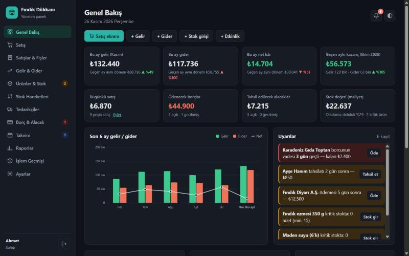
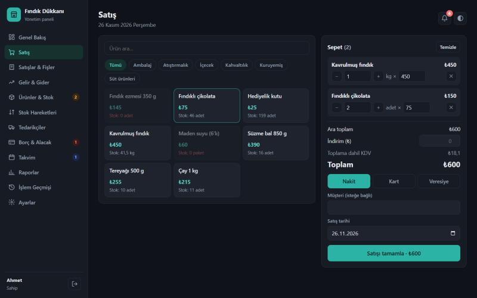
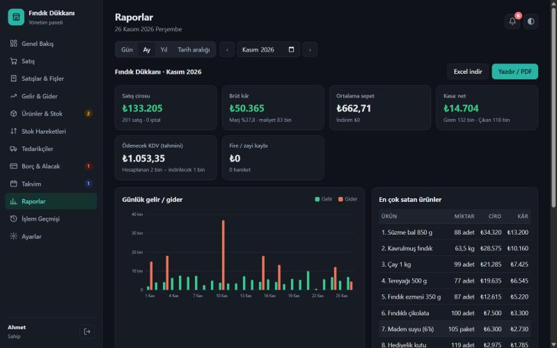
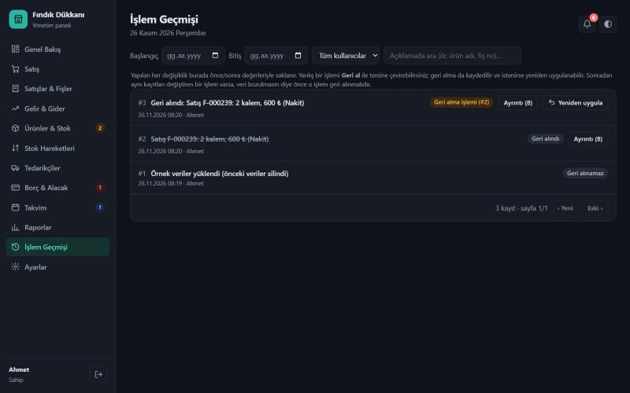

# Dükkan Paneli

[](https://github.com/ahmetarifcesur/dukkan-paneli/actions/workflows/ci.yml)

Küçük bir dükkanın sahibinin işlerini uzaktan takip etmesi için web uygulaması:
- satış (sepet ve fiş),
- stok ve kapasite, stok hareketleri,
- gelir-gider, tedarikçiler, borç-alacak,
- takvim ve raporlar,
- **yapay zekâ asistanı** (Claude): dükkanın durumu hakkında soru-cevap,
- **her değişikliğin geri alınabildiği işlem geçmişi**.

| Genel bakış | Satış ekranı |
|---|---|
|  |  |
| **Raporlar** | **İşlem geçmişi (geri al / yeniden uygula)** |
|  |  |

## Teknolojiler

- **Backend:** C#, ASP.NET Core 10 Minimal API, Entity Framework Core 10 (migrations), SQLite
- **Frontend:** HTML, CSS ve kütüphanesiz JavaScript; telefona kurulabilen PWA
- **Test:** xUnit, 82 test (entegrasyon: `WebApplicationFactory` + geçici veritabanı; birim: saf fonksiyonlar ve bellek içi SQLite)
- **Yapay zekâ:** resmî Anthropic C# kütüphanesi, Claude Opus 5.5
- **CI:** GitHub Actions; her push'ta derleme (uyarılar hata sayılır) ve testler çalışır

## Çalıştırma

Gereken: [.NET 10 SDK](https://dotnet.microsoft.com/download)

```powershell
cd dukkan-paneli
dotnet run --project src/DukkanPaneli.Api --urls http://localhost:5080
```

Tarayıcıda `http://localhost:5080` adresini açın. İlk açılışta **kurulum ekranı** gelir:
- Dükkan adını ve sahip hesabını oluşturursunuz.
- İsterseniz örnek verileri de yükleyebilirsiniz.
- Veritabanı, migration'larla otomatik oluşturulur.

Testler:

```powershell
dotnet test
```

Kodu öğrenmek için: **[docs/OGRENME-REHBERI.md](docs/OGRENME-REHBERI.md)**. Rehberde okuma sırası, bir isteğin uçtan uca
yolculuğu, tasarım kararlarının nedenleri ve alıştırmalar var.

## Mimari

```
src/DukkanPaneli.Api/
  Program.cs                 başlangıç: servisler → ara katmanlar → uç noktalar
  Infrastructure/            kimlik doğrulama, güvenlik başlıkları/CSRF, DI kayıtları
  Common/                    OpResult, Actor, para/KDV hesabı, biçimlendirme
  Data/
    Entities/                veri modeli (her varlık ayrı dosyada)
    AppDb.cs                 EF Core bağlamı ve ilişkiler
    AppDb.Audit.cs           işlem geçmişi ve çakışma kontrollü geri alma
    Migrations/              şema geçmişi
  Features/                  özelliğe göre klasörler
    Sales/                   SalesEndpoints (HTTP) → SaleService (iş kuralları) + modeller
    Catalog/  Finance/  Calendar/  Reports/  History/  Dashboard/  Auth/  Admin/
  wwwroot/                   arayüz (js/core, views-ops, views-admin, forms, main) + PWA
tests/DukkanPaneli.Tests/
  Api/                       uç noktaları gerçek HTTP ile test eder
  Unit/                      saf fonksiyonlar ve servisler
  Support/                   TestApp, ApiTestBase
```

**Katmanlar:**
- **Uç noktalar** incedir: isteği alır, servisi çağırır, sonucu HTTP yanıtına çevirir.
- **İş kuralları** servislerdedir. Servisler HTTP'yi bilmez ve doğrulama hatasını exception yerine `OpResult` ile döndürür.
- **API sözleşmesi** tipli `record` DTO'larla tanımlıdır. Kod adları İngilizcedir; JSON'daki Türkçe değerler (`"Gelir"`, `"Veresiye"` gibi) `JsonStringEnumMemberName` ile korunur.

## Özellikler

| Bölüm | Ne yapar |
|---|---|
| Genel Bakış | Bu ayki ve geçen ayki kazanç, bugünkü satış, borç-alacak, stok değeri, 6 aylık grafik; geciken ödeme, kritik stok ve bugünkü etkinlik uyarıları |
| Satış | Dokunmatik ürün kartları, sepet, indirim, KDV dahil toplam, nakit / kart / veresiye, yazdırılabilir fiş |
| Satışlar & Fişler | Gün, ay, yıl ya da tarih aralığına göre satış listesi, fiş tekrar yazdırma, satış iptali (stok geri gelir) |
| Gelir & Gider | Dönem seçimi, KDV'li gider girişi, CSV. Satıştan ve ödemeden otomatik oluşan kayıtlar kilitlidir |
| Ürünler & Stok | Kapasite doluluğu, kritik stok, stok girişi (peşin ya da tedarikçiye vadeli), fire / iade / sayım / düzeltme |
| Stok Hareketleri | Her stok değişikliğinin kaydı; ürün bazında geçmiş ve **istenen tarihteki stok** |
| Borç & Alacak | Vade takibi, kısmi ödeme ve tahsilat, ödeme iptali |
| Takvim | Etkinlikler, borç ve alacak vadeleri, aylık tekrar |
| Raporlar | Ciro, brüt kâr ve marj, ortalama sepet, en çok satan ürünler, ödeme türleri, kasiyer bazında satış, tahmini KDV, fire kaybı; **Excel** ve **Yazdır / PDF** |
| İşlem Geçmişi | Kim, ne zaman, neyi değiştirdi (önceki ve sonraki değerleriyle). **Geri al** ve **Yeniden uygula** |
| Çalışanlar | Kullanıcı ekleme, düzenleme, devre dışı bırakma; her kişinin bugünkü ve bu ayki satışı, son satışı ve son girişi |
| Ayarlar | Dükkan bilgileri, şifre değiştirme, bildirimler, otomatik yedekler |

### Roller

- **Sahip:** her şeyi görür ve yapar.
- **Çalışan:** satış, stok girişi ve düzeltme, takvim, fişler.
  - Göremez: gelir-gider, borçlar, raporlar, maliyetler, geçmiş, kullanıcı yönetimi.
  - Yapamaz: geçmiş tarihe satış girmek, satış iptal etmek.
  - Bu kurallar **sunucuda** uygulanır; arayüzde gizlemek tek başına yeterli sayılmaz.

### Geçmiş ve geri alma

Her değişiklik `AppDb.SaveAuditedAsync` üzerinden kaydedilir. EF Core'un değişiklik izleyicisinden alınan
etkilenen satırların **önceki ve sonraki** hâli, aynı veritabanı işleminde (transaction) `AuditLogs` tablosuna JSON olarak yazılır.

**Geri al** (`AppDb.UndoAsync`) üç şey yapar:
- eklenen satırları siler,
- silinenleri geri ekler,
- değişenleri eski değerine döndürür.

Etkilenen bir satır sonradan başka bir işlemle değiştiyse veri bozulmasın diye geri almayı **reddeder** ve önce
geri alınması gereken işlemleri listeler. Geri alma da geçmişe yazılır ve **yeniden uygulanabilir**.

### Tutarlılık kuralları

- Stok sadece hareketlerle değişir: stok = hareketlerin toplamı.
- Satışa, ödemeye ya da stok girişine bağlı gelir-gider kayıtları elle silinemez veya düzenlenemez.
- Ürün ve tedarikçi silme aslında arşivlemedir; eski satışlar ve hareketler bozulmaz.
- Nakit esası: veresiye satış ve vadeli alım, tahsil edildiğinde ya da ödendiğinde gelir veya gider olur.

### Güvenlik

- Şifreler ASP.NET Core Identity `PasswordHasher` (PBKDF2) ile saklanır.
- Oturum çerezi `HttpOnly` ve `SameSite=Strict`. Şifre ya da rol değişince veya hesap kapatılınca açık oturumlar hemen düşer.
- Değişiklik isteklerinde özel başlık zorunludur (CSRF koruması).
- Giriş, kurulum ve şifre değiştirme denemeleri sınırlıdır: IP başına dakikada 10.
- Giriş yanıtının süresi, kullanıcı adının var olup olmadığını belli etmez.
- Fiyatı sadece sahip değiştirebilir; çalışanın API'ye gönderdiği fiyat yok sayılır.
- İlk kurulum yayında sadece sunucunun kendisinden ya da **kurulum anahtarıyla** (`Setup__Token`) yapılabilir; siteyi ilk açan yabancı sahip olamaz.
- CSV dışa aktarımında formül gibi başlayan metinler etkisizleştirilir (CSV enjeksiyonu).
- Güvenlik başlıkları gönderilir (CSP, Permissions-Policy, HSTS vb.).

### Yayına alırken

- **HTTPS zorunlu:** uygulamayı Caddy, nginx ya da Cloudflare Tunnel gibi bir ters vekilin (reverse proxy) arkasında çalıştırın.
  Vekil aynı makinedeyse gerçek IP ve HTTPS bilgisi (`X-Forwarded-*`) otomatik kullanılır.
- Kurulumu sunucuda yapmayacaksanız önce `Setup__Token` ortam değişkenini uzun, rastgele bir değerle tanımlayın.
- `App_Data/` klasörü (veritabanı, otomatik yedekler ve oturum anahtarları) kalıcı bir diskte olmalı.
  Disk bozulmasına karşı yedekleri ayrıca başka bir yere (bulut sürücü, USB) kopyalayın.

## Asistan (yapay zekâ)

Sahip, **Asistan** ekranında "Bu ay geçen aya göre nasıl?", "Hangi ürünlerden sipariş vermeliyim?" gibi sorular sorar.
Sunucu dükkanın güncel özetini (kasa, satış, stok, borç-alacak, kullanıcı satışları) çıkarır ve soruyla birlikte Claude'a gönderir.

- **Kurulum:** console.anthropic.com adresinden bir API anahtarı alın ve sunucuda `ANTHROPIC_API_KEY` ortam değişkeni olarak tanımlayın.
  Anahtar yoksa ekran kurulum talimatını gösterir; uygulamanın geri kalanı etkilenmez.
- **Gizlilik:** Müşteri, çalışan ve tedarikçi olmayan kişi adları takma adla gönderilir ("Müşteri-1"); cevapta gerçek adlara geri çevrilir.
  Telefon, e-posta ve notlar gönderilmez. "Hangi veriler gönderiliyor?" düğmesi gönderilen metni olduğu gibi gösterir.
- **Maliyet:** Her soru ücretli bir API çağrısıdır (genelde birkaç kuruş dolar). Kullanıcı başına dakikada 6 soru sınırı var;
  Anthropic konsolundan aylık harcama sınırı da koyabilirsiniz.
- **Ayarlar:** `Assistant__Model` (varsayılan `claude-opus-5-5`), `Assistant__Effort` (`low` / `medium` / `high`).

## Yedekleme ve bakım komutları

Uygulama açıkken **her gün otomatik yedek** alır (`App_Data/backups/dukkan-YYYY-MM-DD.db`) ve son 14 yedeği saklar.
Ayarlar: `Backup__Enabled`, `Backup__Keep`, `Backup__Directory` (ortam değişkeni ya da `appsettings.json`).
Yedekler Ayarlar ekranında da listelenir.

Sunucuda çalıştırılan komutlar (web'den çağrılamaz):

```powershell
dotnet run --project src/DukkanPaneli.Api -- help
```

| Komut | Ne yapar |
|---|---|
| `reset-password <kullanıcı>` | Şifresini unutan kullanıcıya geçici şifre üretir; açık oturumlarını kapatır |
| `backup` | Hemen bir yedek alır (uygulama açıkken de olur) |
| `list-backups` | Yedekleri listeler |
| `restore-backup <dosya>` | Yedeği geri yükler. **Önce uygulamayı durdurun.** Mevcut veri `restore-oncesi-…` adıyla saklanır; bozuk ya da yabancı dosya reddedilir |

## Uzaktan erişim

- **Aynı ağda:** `--urls http://0.0.0.0:5080` ile çalıştırın, telefondan `http://<bilgisayarın-ip-adresi>:5080` adresini açın.
- **İnternetten:** uygulamayı bir sunucuya yükleyin ya da dükkan bilgisayarını Cloudflare Tunnel veya Tailscale ile açın. **Mutlaka HTTPS** kullanın.

Telefonda tarayıcı menüsündeki **"Ana ekrana ekle"** ile uygulama gibi kurulur.

## Bilinen sınırlar / sonraki adımlar

- Aynı anda iki kasiyer aynı son ürünü satarsa ikisi de geçebilir. Ürüne eşzamanlılık belirteci (concurrency token) eklenmeli.
- Arayüz için otomatik test yok.
- Bildirimler panel açıkken ya da arka planda çalışırken gelir. Uygulama tamamen kapalıyken bildirim için Web Push (VAPID) gerekir.
- Fiş bir **bilgi fişidir**; e-Arşiv fatura ya da ÖKC entegrasyonu yok. KDV rakamları tahminidir.
- Geçici şifreyle girişten sonra şifre değiştirmek zorunlu tutulmuyor; kullanıcıya hatırlatılıyor.
- Otomatik yedekler aynı diskte durur; başka bir yere kopyalamak sizin işiniz.
